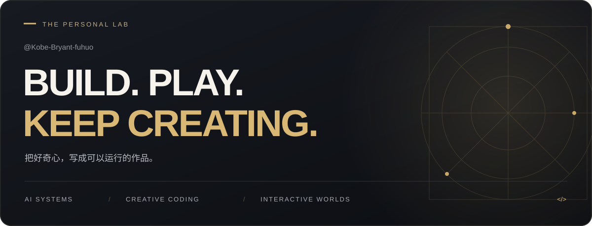
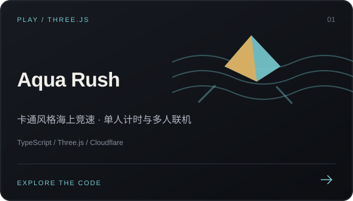
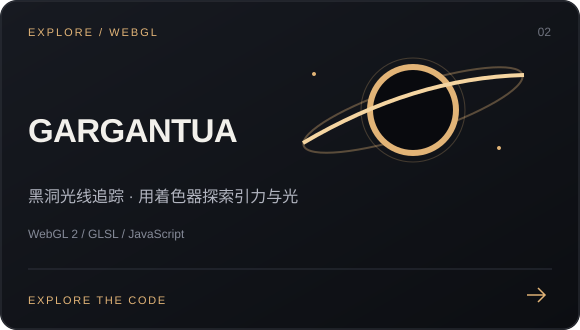
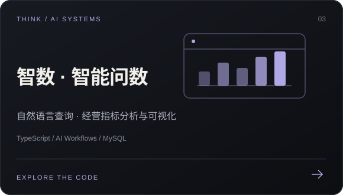
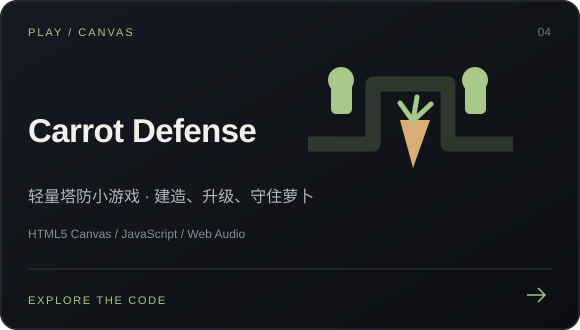

  

  <a href="#about">关于我</a> &nbsp;·&nbsp;
  <a href="#selected-work">精选项目</a> &nbsp;·&nbsp;
  <a href="#toolbox">技术工具箱</a> &nbsp;·&nbsp;
  <a href="https://github.com/Kobe-Bryant-fuhuo?tab=repositories">全部仓库 ↗</a>

 

### 你好，欢迎来到我的个人实验室。

这里记录我在 **AI 应用、实时图形与交互游戏** 方向的项目探索。
从自然语言问数，到黑洞中的光线，再到海面上的竞速——把想法做出来，让代码拥有可感知的体验。

 

## 精选项目  / SELECTED WORK

<table>
  <tr>
    <td width="50%"></td>
    <td width="50%"></td>
  </tr>
  <tr>
    <td width="50%"></td>
    <td width="50%"></td>
  </tr>
</table>

 

## 技术工具箱  / TOOLBOX

项目中使用的技术与工具：

| 方向 | 技术 |
| :--- | :--- |
| **交互与界面** | TypeScript · JavaScript · HTML · CSS |
| **图形与游戏** | Three.js · WebGL 2 · GLSL · Canvas · Web Audio |
| **AI 与数据** | AI Workflows · 自然语言查询 · MySQL · 数据可视化 |
| **构建与交付** | Vite · Cloudflare Workers · Durable Objects · Playwright |

 

---

  <b>保持好奇，持续创造。</b> 
  Made of ideas, experiments, and a little persistence.

